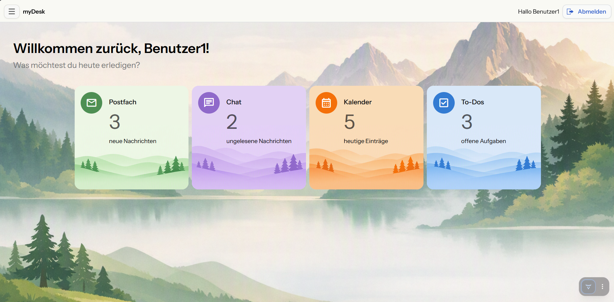

# 🖥️ myDesk

**myDesk** ist eine moderne Webanwendung für persönliche Organisation, Kommunikation und Produktivität.

Die Anwendung vereint **Todos, Kalender, Nachrichten und weitere Produktivitätsfunktionen** in einer zentralen Oberfläche.



## ✨ Features

- 📊 **Dashboard** – personalisierte Startseite mit Übersicht
- ✅ **Todo-Liste** – persönliche Aufgaben erstellen und verwalten
- 📅 **Kalender** – Termine mit FullCalendar verwalten
- ✉️ **Nachrichten** – Nachrichten senden, empfangen und beantworten
- 📎 **Anhänge** – Dateien an Nachrichten anhängen
- 👤 **Benutzerverwaltung** – persönliche Daten und Funktionen pro Benutzer
- 🔐 **Authentifizierung** – abgesicherter Benutzerzugriff

## 🛠️ Technologie-Stack

| Bereich | Technologie |
|---|---|
| Sprache | Java 21 |
| Backend | Spring Boot 4.1.0 |
| UI | Vaadin 25.2.0 |
| Datenbank | PostgreSQL |
| Persistenz | Spring Data JPA |
| Migrationen | Flyway |
| Sicherheit | Spring Security |
| Kalender | FullCalendar for Flow |
| Build | Maven |
| Containerisierung | Docker |

## 🚀 Installation

### Variante 1: Mit Docker

#### Voraussetzungen

- [Docker Desktop](https://www.docker.com/products/docker-desktop/)
- [WSL 2](https://learn.microsoft.com/de-de/windows/wsl/install)

Docker Desktop muss installiert und gestartet sein. Die WSL-2-basierte Engine muss aktiviert sein.

#### Projekt klonen

```bash
git clone https://github.com/NikW5/myDesk.git
cd myDesk
```

#### Umgebungsvariablen konfigurieren

Im Hauptverzeichnis eine lokale Datei namens `.env` erstellen:

```dotenv
DB_PASSWORD=dein_sicheres_passwort
```

Optional können `DB_NAME` und `DB_USERNAME` festgelegt werden. Standardwerte sind `myDesk` und `postgres`.

**Wichtig:** Die `.env`-Datei enthält vertrauliche Zugangsdaten und darf nicht ins Git-Repository eingecheckt werden.

#### Anwendung starten

Docker Desktop starten und im Projektverzeichnis folgenden Befehl ausführen:

```bash
docker compose up --build -d
```

Die Anwendung ist anschließend unter [http://localhost:8080](http://localhost:8080) erreichbar.

#### Anwendung beenden

```bash
docker compose down
```

Die Datenbankdaten bleiben dabei im Docker-Volume erhalten.

#### Fehlerbehebung

**`Access Denied` bei der Docker-Installation**

Fehlende Berechtigungen für den Ordner `.docker` können die Installation verhindern. In diesem Fall die Ordnerberechtigungen überprüfen und bei Bedarf anpassen.

### Variante 2: Lokale Installation mit Maven

#### Voraussetzungen

- Java 21 oder höher
- Maven 3.6 oder höher
- PostgreSQL

#### Projekt klonen

```bash
git clone https://github.com/NikW5/myDesk.git
cd myDesk
```

#### Anwendung starten

Die PostgreSQL-Datenbank muss eingerichtet und die Datenbankverbindung in der Anwendung konfiguriert sein.

Anschließend die Anwendung starten:

```bash
mvn spring-boot:run
```

Die Anwendung ist anschließend unter [http://localhost:8080](http://localhost:8080) erreichbar.

## 📁 Projektstruktur

```text
myDesk/
├── src/
│   ├── main/java/          # Java-Quellcode
│   ├── main/resources/     # Ressourcen und Konfiguration
│   └── test/               # Tests
├── Dockerfile              # Docker-Image der Anwendung
├── compose.yaml            # Anwendung und PostgreSQL
├── pom.xml                 # Maven-Konfiguration
├── mvnw / mvnw.cmd         # Maven Wrapper
└── README.md
```

## 🔗 Repository und Dokumentation

- [GitHub – myDesk](https://github.com/NikW5/myDesk)
- [myDesk Wiki](https://github.com/NikW5/myDesk/wiki)

---

**myDesk befindet sich in aktiver Entwicklung und wird kontinuierlich um neue Funktionen erweitert.**